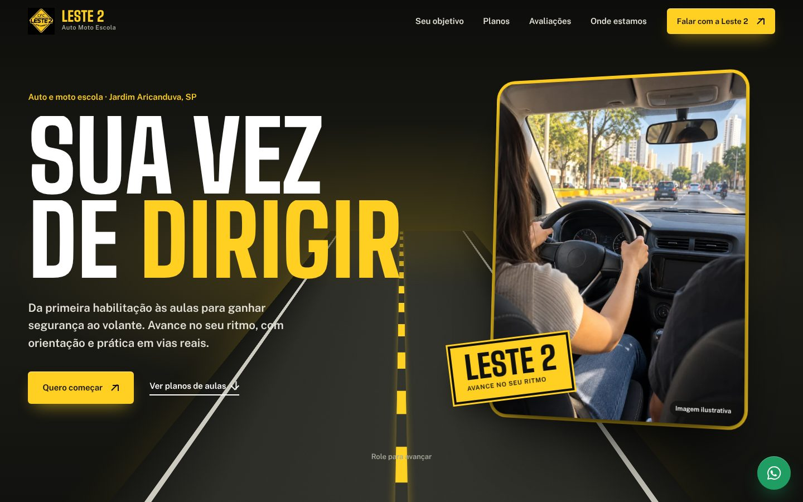
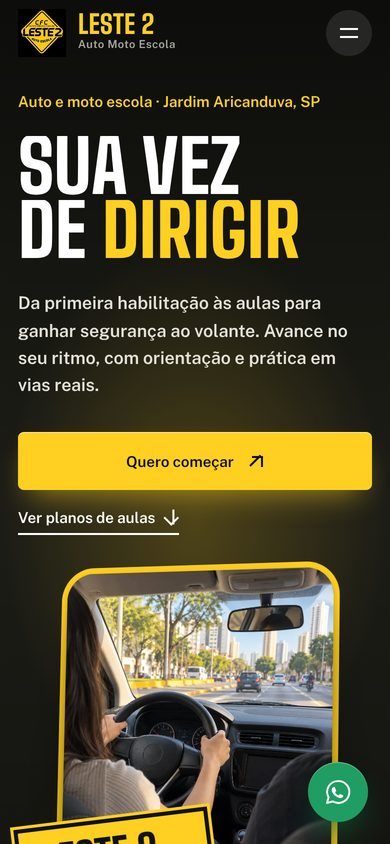

# Auto Moto Escola Leste 2 — Prévia do site

Prévia do novo site da Auto Moto Escola Leste 2: habilitação e aulas práticas no Jardim Aricanduva, em São Paulo.
Preview of the new website for Auto Moto Escola Leste 2, a driving school in Jardim Aricanduva, São Paulo.

[🇧🇷 Português](#-português) · [🇺🇸 English](#-english)

<p align="center">
  
  
</p>

---

## 🇧🇷 Português

### Sobre o projeto

Página única para a **Auto Moto Escola Leste 2**. O site apresenta a primeira habilitação, as aulas práticas, a mudança de categoria e os cursos especializados, além dos pacotes de aulas. A identidade usa preto, amarelo de sinalização e elementos de trânsito. Todas as chamadas levam ao **WhatsApp**.

> ℹ️ **Prévia de demonstração**, feita para apresentar ao cliente. Ainda não foi publicada. Contatos, avaliações e informações comerciais precisam ser confirmados com a empresa antes de ir ao ar. As fontes e pendências estão em `RESEARCH.md`.

**Seções da página:**
- **Abertura:** "Sua vez de dirigir".
- **Qual é o seu próximo passo?:** primeira CNH e outros serviços.
- **Pacotes de aulas:** Start (2 aulas), Básico (6), Essencial (10) e Premium (20).
- **A rua é onde tudo ganha sentido:** as aulas práticas.
- **Depoimentos** de alunos.
- **Contato e endereço**, com mapa.

### Tecnologias

- HTML, CSS e JavaScript puro (sem build)
- [GSAP](https://gsap.com/) + ScrollTrigger para as animações
- [Lenis](https://lenis.darkroom.engineering/) para a rolagem suave
- `prepare_assets.py`: script em Python que otimiza as imagens

### Como ver localmente

Abra o `index.html` no navegador ou suba um servidor simples na pasta (recomendado, por causa das animações):

```bash
python -m http.server 8000   # http://localhost:8000
```

### Estrutura

```
index.html          página completa
styles.css          estilos
script.js           interações e animações
assets/             imagens, logo e bibliotecas
prepare_assets.py   otimização das imagens
review/             capturas de tela da revisão
RESEARCH.md         pesquisa, fontes e pendências
```

---

## 🇺🇸 English

### About

A single-page site for **Auto Moto Escola Leste 2**. It covers first driver's licenses, practical lessons, category upgrades and specialized courses, plus lesson packages. The visual identity uses black, road-sign yellow and traffic elements. Every call-to-action leads to **WhatsApp**.

> ℹ️ **Demo preview** built to pitch to the client. It hasn't been published yet. Contacts, reviews and business details must be confirmed with the company before going live. Sources and open items are in `RESEARCH.md`.

**Page sections:**
- **Hero:** "Your turn to drive".
- **What's your next step?:** first license and other services.
- **Lesson packages:** Start (2 lessons), Basic (6), Essential (10) and Premium (20).
- **The road is where it all makes sense:** practical lessons.
- **Student testimonials.**
- **Contact and address**, with a map.

### Tech stack

- Vanilla HTML, CSS and JavaScript (no build step)
- [GSAP](https://gsap.com/) + ScrollTrigger for animations
- [Lenis](https://lenis.darkroom.engineering/) for smooth scrolling
- `prepare_assets.py`: a Python script that optimizes the images

### Viewing locally

Open `index.html` in a browser, or serve the folder (recommended, because of the animations):

```bash
python -m http.server 8000   # http://localhost:8000
```
